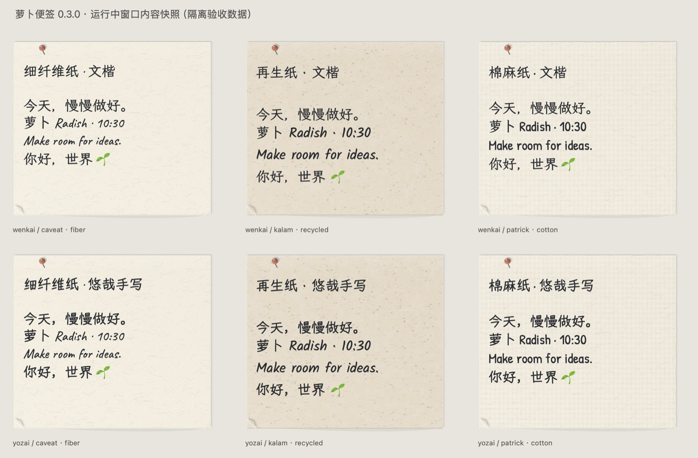
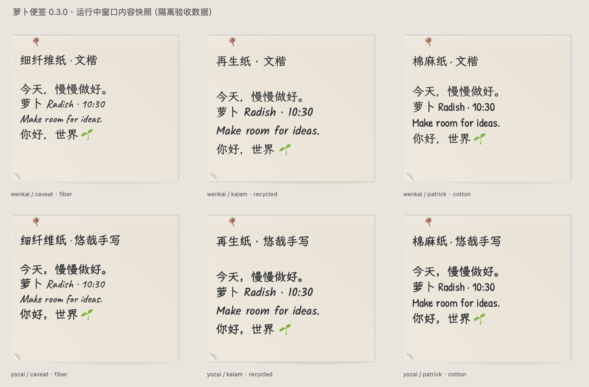

# 🥕 萝卜便签 · RadishNotes

**把今天的工作，写成桌面上的一张张小纸条。**

原生 macOS 桌面便签：保留你自己的摆放，用手写字体、真实纸纹和轻盈的交互，让计划有一点纸张的温度。

[下载 v0.3.1](https://github.com/eugenelo233-commits/RadishNotes/releases/tag/v0.3.1) · [验收报告](TEST_REPORT.md) · [版本说明](CHANGELOG.md)

面向 Apple Silicon Mac，最低系统目标 macOS 14。当前发布包为本地临时签名，尚未经过 Apple 公证；实际验证环境为 macOS 26.4。



## 它有什么不同

| 特点 | 体验 |
| --- | --- |
| **每张纸都是独立原生窗口** | 横条、方形、竖条，自由移动、缩放、重叠；重新打开仍保留自己的布局。 |
| **两套纸张风格** | 写实风格覆盖整张纸面的纤维、再生纸、棉纸纹理；经典风格用柔和纸色区分。10 种颜色，也可随机生成纸色与材质。 |
| **中英文分别选手写字体** | 中文霞鹜文楷 GB、悠哉体；英文 Caveat、Kalam、Patrick Hand。字体随应用提供。 |
| **撕下，完成今天的一件事** | 从左下角拉起，连续预览，松手提交；可以取消，归档后可以撤销。普通“完成”仍留在原处。 |
| **像纸片一样轻轻甩开** | 可选惯性滑动与纸条碰撞；拖动阻尼 0–100%，默认 20%。物理模式默认关闭，并尊重减少动态效果。 |
| **两条独立的时间线** | Deadline 负责截止提醒，自然老化表现纸龄；原纸色独立保留，文字保持清楚。 |
| **旁边有个番茄伙伴** | 独立萝卜宠物窗口，专注、短休息、长休息与番茄收集；轻点它会回应。学习应用与 Edge 域名名单帮助减少分心。 |
| **随时记下一件事** | 默认全局快捷键 **Control + Option + Command + N**；菜单栏也可新建。 |



<details><summary>看看番茄伙伴</summary>


</details>

以上为实际运行的隔离演示便签，摄于 0.3.0；0.3.1 沿用这些视觉效果，并新增阻尼调整。

## 开始使用

1. 从 Releases 下载 `RadishNotes-v0.3.1-macOS-arm64.zip`，解压后将“萝卜便签.app”放入应用程序文件夹。只保留一份常用安装，避免启动旧副本。
2. 启动后从菜单栏萝卜图标新建便签、打开设置、归档或番茄伙伴。
3. **上沿移动、正文选字、右下缩放、左下撕纸**，各自有独立操作区。
4. 默认便签留在桌面层，普通工作窗口可以覆盖；用图钉让单张便签置顶。
5. 在纸张外观中选写实/经典、材质、颜色和字体；设置中可启用随机新纸和物理交互。
6. Deadline 与番茄提醒需要系统通知授权；Edge 域名识别另需系统自动化授权，可按需开启。

应用内 `Command + N` 仅在萝卜便签激活时生效。全局组合键可在设置中选择替代组合；如果注册失败，请检查其他软件是否占用了相同快捷键。

下载版未公证，macOS 可能阻止首次启动。请先核对来源和 Release 的 SHA-256 校验值；无法打开时可自行从源码构建。不要关闭系统整体安全保护。

## 数据与隐私

便签、布局和专注记录保存在本机 `~/Library/Application Support/RadishNotes/`；便签采用原子保存与备份。升级会迁移旧数据，读取失败或遇到未知数据版本时停止写入，避免用空数据覆盖原文件。备份整个目录即可保留自己的便签。

专注提醒按前台应用和可选的 Edge 当前网页**域名**判断，超过宽限时间后提醒，可临时允许本轮访问。浏览器访问课程视频和娱乐视频无法仅凭域名可靠区分，请自行维护名单。应用不读取页面正文、不录屏，也不上传便签或专注记录。

## 从源码构建

需要 Apple Silicon Mac、Xcode Command Line Tools（提供 Swift、SDK）和 Python 3（仅用于获取字体）。本版使用 Swift 6.3.3 编译、Swift 5 语言模式。

```sh
git clone https://github.com/eugenelo233-commits/RadishNotes.git
cd RadishNotes
python3 scripts/fetch-fonts.py
zsh test.sh
zsh build.sh
open 萝卜便签.app
```

字体通过固定版本 URL 下载，并逐文件校验 SHA-256；Git 仓库保留清单和授权，Release 的 `source-with-fonts.zip` 已包含字体，可离线构建。构建脚本在字体缺失或校验失败时退出。`RADISH_BUILD_APP` 可指定应用输出位置。

## 实现

- Swift + AppKit + SwiftUI，无 Electron / WebView 主界面。
- 每张便签一个 `NSWindow`，正文使用 `NSTextView`，保留原生编辑、选区与撤销。
- `Model.swift` / `App.swift`：数据、迁移与窗口协调。
- `Appearance.swift` / `Interactions.swift`：固定纸纹、光影、撕纸手势。
- `PaperPhysics.swift` / `PhysicsModel.swift`：窗口惯性、阻尼与碰撞。
- `Focus*` / `EdgeSiteReader.swift`：番茄伙伴、专注名单和域名读取。
- `DeadlineScheduler.swift`：本地通知调度与去重。

自动检查 **82/82 通过**；系统窗口行为、真实拼音与通知送达的实测范围分别见 [TEST_REPORT.md](TEST_REPORT.md)。未覆盖的系统模式不视为通过。

## 使用权利

本项目目前**未设置开源许可**。源码公开展示不代表授权复制、修改或再分发项目代码；相关权利由权利人保留。如需这些使用权限，请先联系仓库维护者。

第三方字体遵循各自 SIL Open Font License 1.1，详见 [第三方说明](THIRD_PARTY_NOTICES.md) 与 `Resources/Fonts/*-OFL.txt`。字体许可不改变本项目代码的授权状态。
